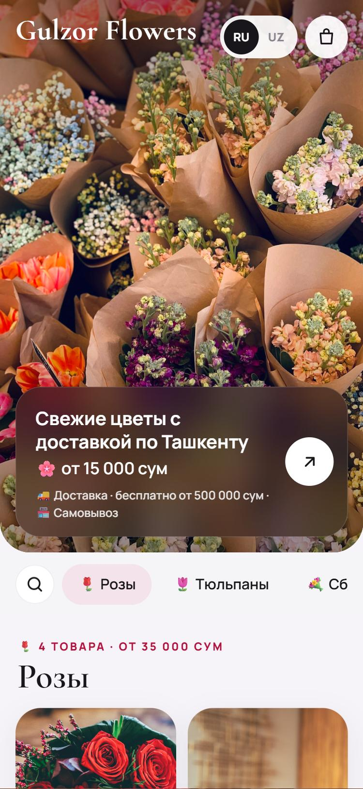
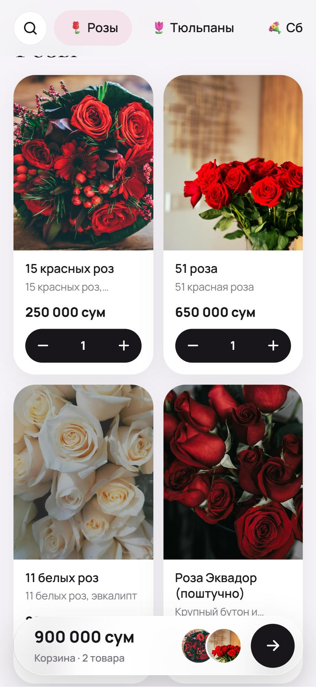
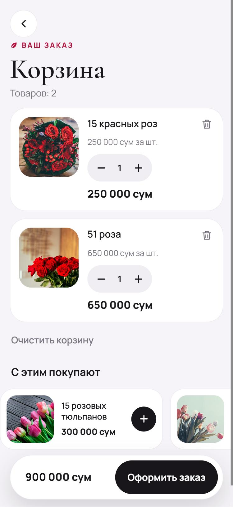
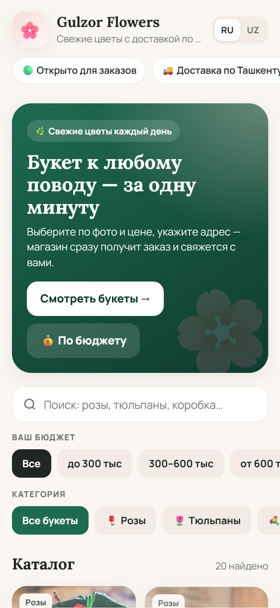

<h1 align="center">🌸 Gulzor Flowers — a shop inside Telegram</h1>

<p align="center">
A Telegram Mini App (two designs) + a Python order bot for a <b>demo</b> flower shop.<br>
Customers browse, fill a cart and check out without leaving Telegram — the owner gets a ready order in a Telegram group.
</p>

<p align="center">
  <a href="https://kldidar.github.io/flowers-shop/webapp/?shop=example_flowers"></a>
  <a href="https://kldidar.github.io/flowers-shop/webapp/classic.html?shop=example_flowers"></a>
  <a href="https://kldidar.github.io"></a>
</p>

<p align="center">
  
  
  
  
</p>

> “Gulzor Flowers” is a fictional shop made for this portfolio. Photos: [Unsplash](https://unsplash.com).
> Opened in a normal browser the shop runs in preview mode; inside Telegram the order goes to the bot.

## Features

**Mini App — boutique design (`webapp/index.html`)**
- Full-bleed hero, sticky category tabs with scroll-spy, search
- Large photo cards, quantity steppers, floating glass cart with item thumbnails
- Full-page cart with a “goes well with” upsell row
- Checkout: delivery or pickup, free-delivery progress bar, field validation
- Light and dark theme (follows Telegram), Russian and Uzbek, Telegram back button and haptics

**Mini App — classic design (`webapp/classic.html`)**
- Cream-and-emerald palette, budget filters, bottom-sheet product card and checkout

**Order bot (Python, not in this repository)**
- Takes orders from the Mini App (`Telegram.WebApp.sendData`) or from a chat flow
- Rebuilds the cart and prices from the shop config on the server, so a customer can't change a price
- Saves orders to SQLite; `/orders` shows the latest ones to the owner
- One bot can serve many shops; 22 unit tests; standard library only

## How it works

```
Customer ──▶ Telegram bot ──(button)──▶ Mini App (this repo, GitHub Pages)
                 ▲                              │
                 └──── order JSON (sendData) ◀──┘
                 │
                 └──▶ owner's Telegram group: “🆕 New order #17 … 💬 Message the customer”
```

One page serves every shop: `webapp/?shop=<name>` loads `webapp/shops/<name>.json`
(catalog, prices, delivery rules, texts in RU/UZ).

## Structure

```
webapp/
  index.html        boutique design (v2)
  classic.html      classic design (v1)
  shops/            public shop configs (JSON)
screens/            screenshots for this README
```

## Tech

HTML · CSS · JavaScript (no frameworks) · Telegram Mini Apps API · GitHub Pages — bot: Python, Telegram Bot API, SQLite

---

Made by **Didar Kuliyev** · [Portfolio](https://kldidar.github.io) · [Telegram @kuliyev_didar](https://t.me/kuliyev_didar)
